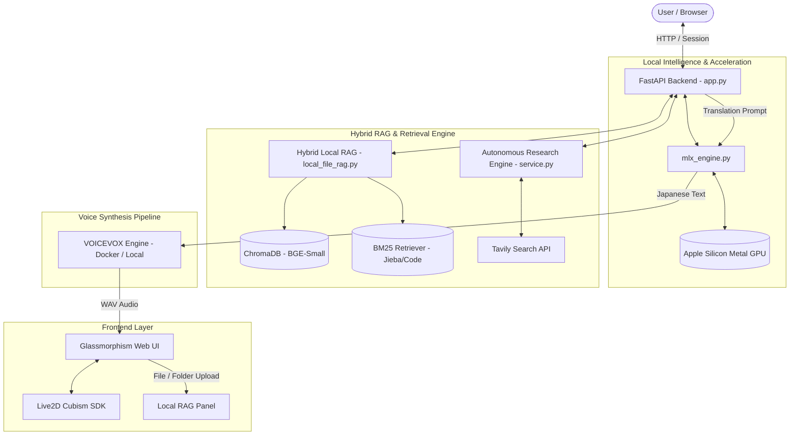

# 🌙 Live2D Chatbot (Tsukuyomi-chan / 月讀醬)

A cute, interactive, and intelligent virtual desktop companion powered by local AI technologies. **Tsukuyomi-chan (月讀醬)** combines expressive Live2D animation, natural Japanese voice synthesis, Apple Silicon native MLX acceleration, and an advanced Hybrid Local/Web RAG system into a unified companion experience.

---

## ✨ Key Features

* **💬 Interactive Maid Persona**: Engages in conversation with emotional awareness (`[emotion:tag]`), affection/intimacy progression (`冷淡期` → `羈絆期`), and expressive Live2D animations.
* **⚡ Apple Silicon Native MLX Inference**: Powered by local **MLX** (`mlx-lm`) with a thread-safe Metal GPU inference lock, delivering ultra-fast token generation directly on your Mac.
* **📎 Hybrid Local RAG (Code & Paper Specialist)**:
  * **Ensemble Retrieval**: Combines keyword search (**BM25** with Jieba tokenization) and dense semantic search (**BGE-Small** embeddings).
* **🌐 Real-Time Web Search in Chat**: Instant web search toggle powered by the Tavily Search API, rendering clickable citation badges without polluting session memory.
* **🔬 Autonomous Research Engine**: Multi-region search, structured outline synthesis, and parallel section generation with duplicate-suppression filters.
* **🗣️ Japanese Voice Synthesis**: Seamless speech pipeline via local **VOICEVOX** engine (*Catshibi / 猫使ビィ* voicebank) with auto-translation.
* **🎨 Modern Web UI**: Responsive dark/light theme, Live2D viewport collapsing, dynamic font sizing, custom glowing scrollbars, and SQLite-backed persistent settings.

---

## 🏗️ System Architecture



---

## 📋 Prerequisites

* **Operating System**: macOS (Apple Silicon M-Series strongly recommended for MLX) or Linux / Windows (with fallback inference).
* **Python**: `3.10` or higher (Managed via `uv` or `venv`).
* **Docker Desktop** (Optional, required if running VOICEVOX via Docker).
* **Tavily API Key** (Optional, required for web search & real-time report generation).

---

## 🚀 Installation & Setup

### 1. Clone Repository & Setup Environment

```bash
# Clone the repository
git clone [https://github.com/Gabriel0w0/tsukuyomi-chat.git](https://github.com/Gabriel0w0/tsukuyomi-chat.git)
cd tsukuyomi-chat

# Create and activate virtual environment using uv or venv
uv venv
source .venv/bin/activate

# Install dependencies
uv pip install -r requirements.txt

```

### 2. Set up VOICEVOX Engine (TTS)

Run the VOICEVOX engine locally via Docker:

```bash
# For macOS / Linux:
docker run -d --name voicevox_engine -p 50021:50021 voicevox/voicevox_engine:latest

```

### 3. Configuration

Check or create `config.py` for global defaults:

* `CHAT_MODEL`: The HuggingFace / MLX model path (e.g., `mlx-community/Ministral-3B-Instruct-4bit` or `gemma-3`).
* `VOICEVOX_URL`: URL of the TTS engine (default: `http://localhost:50021`).
* `DB_FILE`: Path to SQLite database (default: `memory.db`).

---

## ▶️ Usage

Start the server using `uvicorn`:

```bash
uvicorn app:app --host 127.0.0.1 --port 5000 --reload

```

Open your browser and navigate to:
👉 **`http://127.0.0.1:5000`**

### Features at a Glance:

1. **Chat Mode (`Chat`)**: Chat freely with Tsukuyomi-chan. Toggle the **Globe (🌐)** icon to fetch live web results.
2. **Local RAG Attachment (📎)**: Click the paperclip button on the bottom right to drop C++ project folders or PDF papers. Tsukuyomi-chan will quote exact line numbers and paper pages when answering.
3. **Research Mode (`Research`)**: Enter 
any topic to automatically generate an in-depth, multi-chapter research report.
4. **Settings (⚙️)**: Customize themes, font size, and configure your Tavily API Key or target LLMs.

---

## 🎭 Emotion Tag Protocol

The model dynamically inserts emotional tags to drive Live2D facial expressions:

| Emotion Tag | Live2D Expression | Behavior Description |
| --- | --- | --- |
| `[emotion:joy]` | Happy / Laugh | Positive feedback, excited reaction |
| `[emotion:sad]` | Tearful / Sad | Empathy, sorrow, or feeling touched |
| `[emotion:angry]` | Pouting / Angry | Mild Tsundere frustration or teasing |
| `[emotion:neutral]` | Calm | Attentive, analytical response |
| `[emotion:cute]` | Winking / Playful | Flirty, sweet, or playful remark |
| `[emotion:shy]` | Blushing | Embarrassment or deep affection |

---

## ⚖️ Legal & Acknowledgments

1. **VOICEVOX**: Free text-to-speech software. Audio generated using the **Catshibi (猫使ビィ)** voicebank adheres to [VOICEVOX Terms of Use](https://voicevox.hiroshiba.jp/).
2. **Live2D Models**: Sample model **"Hiyori Momose (桃瀬日和)"** is owned by Live2D Inc. and is strictly licensed for **personal, non-commercial, and academic research purposes only** ([Live2D Sample Model EULA](https://www.live2d.com/eula/live2d-sample-model-terms_en.html)).
3. **Open-Source Stack**: Built with [MLX](https://github.com/ml-explore/mlx), [LangChain](https://github.com/langchain-ai/langchain), [FastAPI](https://fastapi.tiangolo.com/), [Chroma](https://www.trychroma.com/), and [Tavily](https://tavily.com/).

---

> **Disclaimer**: This project is intended for educational purposes. The developers are not responsible for any misuse of the generated content or violation of the third-party asset licenses.
